# NEXUS AI — Master Product Architecture Specification

**Product**: NEXUS AI  
**Tagline**: *Your Personal Intelligence. One Connected Workspace.*  
**Category**: Personal AI Operating System  
**Status**: Architecture & Design Phase (Phase 1 Baseline)  

---

## 1. System Overview & Vision

Nexus AI is designed as a unified Personal AI Operating System. Rather than functioning as a collection of disjointed tools or a superficial wrapper around an LLM, Nexus AI unifies **Productivity (LifeOS)**, **Career Intelligence (CareerOS & Resume Engine)**, **Knowledge Retrieval (Second Brain & RAG)**, **Automated Action Engine**, and **Autonomous Opportunity Matching** atop a shared **Personal Memory Engine** and **Knowledge Graph**.

```mermaid
flowchart TB
    subgraph Client ["Client Presentation Tier (Next.js 14+ / TypeScript)"]
        UI["Web App (Tailwind CSS, Lucide, Framer Motion)"]
        PWA["Mobile / Responsive Shell"]
        Capture["Universal Capture Widget"]
    end

    subgraph Gateway ["API & Security Gateway"]
        Auth["Auth.js / JWT Session Verification"]
        RateLimit["Token Bucket Rate Limiter"]
        Entitlements["Subscription & Entitlement Guard"]
        Audit["Audit & Security Logger"]
    end

    subgraph CoreBackend ["Nexus Core Services (FastAPI Modular Monolith)"]
        LifeOS["LifeOS Service (Planner, Tasks, Habits, Calendar)"]
        CareerOS["CareerOS Service (Profile, Skills, Roadmaps)"]
        ResumeEngine["Resume Intelligence Engine (ATS, Parser, PDF Generator)"]
        JobEngine["Smart Job Engine (Scrapers, Radar, Application Tracker)"]
        SecondBrain["Second Brain Service (RAG, Chunks, Notes, Vector Search)"]
        MemoryEngine["Personal Memory Engine (Episodic, Semantic & Preferences)"]
        BillingEngine["Monetization & Credit Wallet (Razorpay/Cashfree Sandbox)"]
        AdminEngine["Owner & Admin Dashboard (Revenue, AI Costs, Retention)"]
    end

    subgraph AILayer ["Nexus Personal Intelligence Layer"]
        Orchestrator["AI Orchestrator & Model Router"]
        GeminiAdapter["Gemini API Adapter (Flash 2.0 / Pro)"]
        OpenAIAdapter["OpenAI API Adapter (GPT-4o / Text-Embedding-3)"]
        EmbeddingService["Vector Embeddings Service"]
        PromptGuard["Input Sanitizer & Prompt Injection Guard"]
    end

    subgraph StorageTier ["Persistence & Data Layer"]
        PG[("PostgreSQL 16")]
        VectorExt[("pgvector Extension")]
        ObjectStore[("Object Storage (S3 / Supabase Storage)")]
        CacheStore[("Redis / In-Memory Cache")]
    end

    Client --> Gateway
    Gateway --> CoreBackend
    CoreBackend --> AILayer
    CoreBackend --> StorageTier
    AILayer --> StorageTier
```

---

## 2. Core Architectural Principles

1. **Modular Monolith for Velocity and Clean Isolation**:
   - The backend is organized as a domain-driven modular monolith in FastAPI.
   - Each module (`memory`, `career`, `resume`, `lifeos`, `second_brain`, `billing`, `admin`) maintains isolated domain logic, schemas, and routes, allowing future decomposition into independent microservices if scale demands.
2. **Context-Aware Shared Intelligence**:
   - The **Personal Memory Engine** and **Knowledge Graph** provide a shared context layer. When a user adds a project in `Project Hub`, it automatically surfaces as verified evidence in `CareerOS`, updates skill proficiency in `Learning Hub`, and is dynamically selected by `Resume Intelligence` when tailoring resumes.
3. **Defense-in-Depth & Data Isolation**:
   - Every database query strictly filters by `user_id`. Multi-tenancy is enforced at the database query level and verified in middleware.
   - User document uploads and job postings are treated as untrusted input. Prompt injection barriers prevent untrusted user documents from hijacking system prompts.
4. **Resilient AI Provider Abstraction**:
   - The AI layer features an abstract interface (`AIProviderBase`) with implementations for Google Gemini and OpenAI.
   - Cost-effective models (e.g., Gemini 2.0 Flash) handle routine tasks (summarization, categorization, metadata extraction), while reasoning models handle complex resume rewriting, career roadmaps, and knowledge synthesis.
5. **Strict Commercial Billing & Credit Safety**:
   - Feature entitlements and credit balances are verified server-side prior to executing any AI workflow.
   - Credit deduction is atomic with rollbacks if an external AI execution fails unexpectedly.

---

## 3. High-Level Module Blueprint

| Module | Core Purpose | Primary Integrations & Storage |
| :--- | :--- | :--- |
| **Nexus Core & Chat** | Central conversational interface with multi-modal memory access | Memory Engine, Vector DB, Chat History |
| **Personal Memory Engine** | Explicit & inferred user preferences, facts, achievements, goals | `memories` table, vector embeddings, audit trail |
| **LifeOS** | Daily/weekly planner, time-blocking, task management, habit tracker | `tasks`, `habits`, `schedules`, calendar sync |
| **CareerOS** | Master career portfolio, education, work experience, skill graphs | `user_profiles`, `skills`, `experiences`, `skill_evidence` |
| **Resume Intelligence** | Resume parsing, JD keyword extraction, ATS scoring, PDF generation | `resumes`, `resume_versions`, WeasyPrint / pdfkit |
| **Smart Job Engine** | Opportunity Radar, Assisted Apply, application status command center | `job_opportunities`, `job_applications` |
| **Second Brain** | Semantic document storage, chunking, RAG-based Q&A, flashcards | `documents`, `document_chunks`, pgvector |
| **Project & Learning Hub** | Project tracking, GitHub linking, study roadmaps, revision schedules | `projects`, `learning_paths`, `certificates` |
| **Cyber Hub** | Defensive privacy audit, password strength analyzer, URL phishing checks | Local heuristics, cryptographic hash verification |
| **Universal Capture** | Save to Nexus via web share, quick notes, bookmark processor | Asynchronous background workers |
| **Billing & Credits** | Subscription tiers, AI wallet, transaction ledger, invoice generation | Razorpay / Cashfree sandbox webhook processor |
| **Admin Analytics** | Real-time MRR/ARR, token expenditure, DAU/MAU, unit economics | Timeseries rollups, aggregations |

---

## 4. Security & Compliance Architecture

- **Authentication**: JWT tokens signed with SHA-256 with short expiry, paired with secure HTTP-only refresh tokens.
- **Authorization**: Role-Based Access Control (`User`, `Pro`, `CampusAdmin`, `SuperAdmin`).
- **Data Encryption**:
  - In-transit: TLS 1.3 enforced.
  - At-rest: AES-256 for sensitive credentials; encrypted secrets store for OAuth tokens and third-party keys.
- **AI Safety**:
  - No user passwords or unhashed secrets are ever transmitted to LLM context windows.
  - Truthful resume generation constraint: strict system prompts prohibit inventing unverified credentials or metrics.
