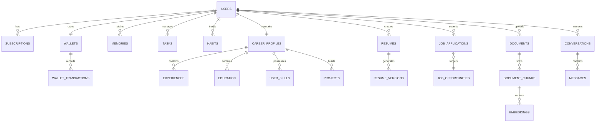

# NEXUS AI — Complete Database Architecture & Schema Specification

**Database Engine**: PostgreSQL 16+ with `pgvector` and `uuid-ossp` extensions  
**Architecture**: Fully Normalized, Multi-Tenant with strict `user_id` foreign keys and Row-Level Isolation.

---

## 1. Entity Relationship Overview



---

## 2. Core DDL Table Definitions

### A. Authentication, Users & Identity

```sql
CREATE EXTENSION IF NOT EXISTS "uuid-ossp";
CREATE EXTENSION IF NOT EXISTS "vector";

CREATE TYPE user_role AS ENUM ('user', 'pro', 'campus_admin', 'super_admin');
CREATE TYPE subscription_tier AS ENUM ('free', 'plus', 'pro', 'campus');
CREATE TYPE subscription_status AS ENUM ('active', 'past_due', 'canceled', 'trialing');

CREATE TABLE users (
    id UUID PRIMARY KEY DEFAULT uuid_generate_v4(),
    email VARCHAR(255) UNIQUE NOT NULL,
    hashed_password VARCHAR(255) NOT NULL,
    full_name VARCHAR(255) NOT NULL,
    avatar_url TEXT,
    role user_role DEFAULT 'user' NOT NULL,
    is_verified BOOLEAN DEFAULT FALSE NOT NULL,
    created_at TIMESTAMP WITH TIME ZONE DEFAULT CURRENT_TIMESTAMP NOT NULL,
    updated_at TIMESTAMP WITH TIME ZONE DEFAULT CURRENT_TIMESTAMP NOT NULL
);

CREATE INDEX idx_users_email ON users(email);
```

### B. Monetization, Subscriptions & AI Credits

```sql
CREATE TABLE subscription_plans (
    id VARCHAR(50) PRIMARY KEY, -- 'free', 'plus_monthly', 'pro_monthly', 'pro_annual'
    tier subscription_tier NOT NULL,
    name VARCHAR(100) NOT NULL,
    price_inr NUMERIC(10, 2) NOT NULL,
    billing_period VARCHAR(20) NOT NULL, -- 'monthly', 'annual', 'lifetime'
    ai_credits_monthly INTEGER NOT NULL,
    features_json JSONB NOT NULL DEFAULT '{}',
    is_active BOOLEAN DEFAULT TRUE NOT NULL
);

CREATE TABLE subscriptions (
    id UUID PRIMARY KEY DEFAULT uuid_generate_v4(),
    user_id UUID NOT NULL REFERENCES users(id) ON DELETE CASCADE,
    plan_id VARCHAR(50) NOT NULL REFERENCES subscription_plans(id),
    status subscription_status DEFAULT 'active' NOT NULL,
    current_period_start TIMESTAMP WITH TIME ZONE NOT NULL,
    current_period_end TIMESTAMP WITH TIME ZONE NOT NULL,
    cancel_at_period_end BOOLEAN DEFAULT FALSE NOT NULL,
    gateway_subscription_id VARCHAR(255),
    gateway_customer_id VARCHAR(255),
    created_at TIMESTAMP WITH TIME ZONE DEFAULT CURRENT_TIMESTAMP NOT NULL,
    updated_at TIMESTAMP WITH TIME ZONE DEFAULT CURRENT_TIMESTAMP NOT NULL
);

CREATE TABLE wallets (
    id UUID PRIMARY KEY DEFAULT uuid_generate_v4(),
    user_id UUID UNIQUE NOT NULL REFERENCES users(id) ON DELETE CASCADE,
    credits_balance INTEGER DEFAULT 50 NOT NULL,
    total_credits_purchased INTEGER DEFAULT 0 NOT NULL,
    total_credits_spent INTEGER DEFAULT 0 NOT NULL,
    updated_at TIMESTAMP WITH TIME ZONE DEFAULT CURRENT_TIMESTAMP NOT NULL
);

CREATE TYPE transaction_type AS ENUM ('grant', 'purchase', 'deduct', 'refund');

CREATE TABLE wallet_transactions (
    id UUID PRIMARY KEY DEFAULT uuid_generate_v4(),
    wallet_id UUID NOT NULL REFERENCES wallets(id) ON DELETE CASCADE,
    user_id UUID NOT NULL REFERENCES users(id) ON DELETE CASCADE,
    amount INTEGER NOT NULL, -- positive for credit, negative for debit
    balance_after INTEGER NOT NULL,
    transaction_type transaction_type NOT NULL,
    feature_name VARCHAR(100) NOT NULL, -- 'resume_tailor', 'doc_rag', 'code_review'
    reference_id VARCHAR(255),
    description TEXT,
    created_at TIMESTAMP WITH TIME ZONE DEFAULT CURRENT_TIMESTAMP NOT NULL
);

CREATE TABLE payment_orders (
    id UUID PRIMARY KEY DEFAULT uuid_generate_v4(),
    user_id UUID NOT NULL REFERENCES users(id) ON DELETE CASCADE,
    gateway_order_id VARCHAR(255) UNIQUE NOT NULL,
    gateway_provider VARCHAR(50) NOT NULL, -- 'razorpay', 'cashfree'
    amount NUMERIC(10, 2) NOT NULL,
    currency VARCHAR(10) DEFAULT 'INR' NOT NULL,
    status VARCHAR(50) DEFAULT 'created' NOT NULL, -- 'created', 'paid', 'failed'
    signature VARCHAR(512),
    receipt_id VARCHAR(100),
    metadata JSONB DEFAULT '{}',
    created_at TIMESTAMP WITH TIME ZONE DEFAULT CURRENT_TIMESTAMP NOT NULL,
    updated_at TIMESTAMP WITH TIME ZONE DEFAULT CURRENT_TIMESTAMP NOT NULL
);
```

### C. Personal Memory Engine & Knowledge Graph

```sql
CREATE TYPE memory_category AS ENUM ('preference', 'goal', 'skill', 'fact', 'achievement', 'career_history', 'lifestyle');

CREATE TABLE memories (
    id UUID PRIMARY KEY DEFAULT uuid_generate_v4(),
    user_id UUID NOT NULL REFERENCES users(id) ON DELETE CASCADE,
    category memory_category DEFAULT 'fact' NOT NULL,
    content TEXT NOT NULL,
    source VARCHAR(100) DEFAULT 'user_chat',
    confidence_score REAL DEFAULT 1.0,
    is_active BOOLEAN DEFAULT TRUE NOT NULL,
    embedding vector(768), -- compatible with text-embedding-004 / text-embedding-3-small
    created_at TIMESTAMP WITH TIME ZONE DEFAULT CURRENT_TIMESTAMP NOT NULL,
    updated_at TIMESTAMP WITH TIME ZONE DEFAULT CURRENT_TIMESTAMP NOT NULL
);

CREATE INDEX idx_memories_user_cat ON memories(user_id, category);
```

### D. LifeOS (Planner, Tasks, Habits)

```sql
CREATE TYPE task_priority AS ENUM ('low', 'medium', 'high', 'urgent');
CREATE TYPE task_status AS ENUM ('todo', 'in_progress', 'completed', 'archived');

CREATE TABLE tasks (
    id UUID PRIMARY KEY DEFAULT uuid_generate_v4(),
    user_id UUID NOT NULL REFERENCES users(id) ON DELETE CASCADE,
    title VARCHAR(255) NOT NULL,
    description TEXT,
    priority task_priority DEFAULT 'medium' NOT NULL,
    status task_status DEFAULT 'todo' NOT NULL,
    due_date TIMESTAMP WITH TIME ZONE,
    estimated_minutes INTEGER,
    tags TEXT[] DEFAULT '{}',
    is_ai_generated BOOLEAN DEFAULT FALSE,
    created_at TIMESTAMP WITH TIME ZONE DEFAULT CURRENT_TIMESTAMP NOT NULL,
    updated_at TIMESTAMP WITH TIME ZONE DEFAULT CURRENT_TIMESTAMP NOT NULL
);

CREATE TABLE habits (
    id UUID PRIMARY KEY DEFAULT uuid_generate_v4(),
    user_id UUID NOT NULL REFERENCES users(id) ON DELETE CASCADE,
    name VARCHAR(150) NOT NULL,
    frequency VARCHAR(50) DEFAULT 'daily' NOT NULL,
    streak_count INTEGER DEFAULT 0 NOT NULL,
    target_days_per_week INTEGER DEFAULT 7,
    last_completed_at DATE,
    created_at TIMESTAMP WITH TIME ZONE DEFAULT CURRENT_TIMESTAMP NOT NULL
);
```

### E. CareerOS, Skills & Projects

```sql
CREATE TABLE career_profiles (
    id UUID PRIMARY KEY DEFAULT uuid_generate_v4(),
    user_id UUID UNIQUE NOT NULL REFERENCES users(id) ON DELETE CASCADE,
    headline VARCHAR(255),
    target_role VARCHAR(255),
    years_experience NUMERIC(3, 1) DEFAULT 0.0,
    github_url TEXT,
    linkedin_url TEXT,
    portfolio_url TEXT,
    bio TEXT,
    verified_status BOOLEAN DEFAULT FALSE,
    updated_at TIMESTAMP WITH TIME ZONE DEFAULT CURRENT_TIMESTAMP NOT NULL
);

CREATE TABLE user_skills (
    id UUID PRIMARY KEY DEFAULT uuid_generate_v4(),
    profile_id UUID NOT NULL REFERENCES career_profiles(id) ON DELETE CASCADE,
    skill_name VARCHAR(100) NOT NULL,
    category VARCHAR(50) DEFAULT 'technical', -- 'technical', 'soft', 'tool'
    proficiency_level INTEGER DEFAULT 1, -- 1-5 scale
    is_verified BOOLEAN DEFAULT FALSE,
    evidence_url TEXT
);

CREATE TABLE projects (
    id UUID PRIMARY KEY DEFAULT uuid_generate_v4(),
    user_id UUID NOT NULL REFERENCES users(id) ON DELETE CASCADE,
    title VARCHAR(200) NOT NULL,
    description TEXT NOT NULL,
    technologies TEXT[] DEFAULT '{}',
    repo_url TEXT,
    live_url TEXT,
    key_achievements TEXT[] DEFAULT '{}',
    is_featured BOOLEAN DEFAULT FALSE,
    created_at TIMESTAMP WITH TIME ZONE DEFAULT CURRENT_TIMESTAMP NOT NULL
);
```

### F. Resume Intelligence & Job Engine

```sql
CREATE TABLE resumes (
    id UUID PRIMARY KEY DEFAULT uuid_generate_v4(),
    user_id UUID NOT NULL REFERENCES users(id) ON DELETE CASCADE,
    title VARCHAR(200) NOT NULL,
    parsed_json JSONB DEFAULT '{}' NOT NULL,
    raw_text TEXT,
    file_url TEXT,
    is_master BOOLEAN DEFAULT FALSE,
    created_at TIMESTAMP WITH TIME ZONE DEFAULT CURRENT_TIMESTAMP NOT NULL
);

CREATE TABLE resume_versions (
    id UUID PRIMARY KEY DEFAULT uuid_generate_v4(),
    resume_id UUID NOT NULL REFERENCES resumes(id) ON DELETE CASCADE,
    target_job_title VARCHAR(255),
    target_company VARCHAR(255),
    job_description_raw TEXT,
    ats_score INTEGER,
    tailored_json JSONB NOT NULL,
    generated_pdf_url TEXT,
    changes_summary TEXT,
    created_at TIMESTAMP WITH TIME ZONE DEFAULT CURRENT_TIMESTAMP NOT NULL
);

CREATE TYPE application_status AS ENUM (
    'saved', 'ready_to_apply', 'applied', 'assessment', 
    'interview', 'shortlisted', 'offer', 'rejected', 'follow_up'
);

CREATE TABLE job_opportunities (
    id UUID PRIMARY KEY DEFAULT uuid_generate_v4(),
    company_name VARCHAR(200) NOT NULL,
    job_title VARCHAR(255) NOT NULL,
    location VARCHAR(200),
    employment_type VARCHAR(50), -- 'full_time', 'internship', 'remote'
    salary_range VARCHAR(100),
    description TEXT NOT NULL,
    required_skills TEXT[] DEFAULT '{}',
    source_url TEXT NOT NULL,
    deadline DATE,
    created_at TIMESTAMP WITH TIME ZONE DEFAULT CURRENT_TIMESTAMP NOT NULL
);

CREATE TABLE job_applications (
    id UUID PRIMARY KEY DEFAULT uuid_generate_v4(),
    user_id UUID NOT NULL REFERENCES users(id) ON DELETE CASCADE,
    opportunity_id UUID REFERENCES job_opportunities(id) ON DELETE SET NULL,
    company_name VARCHAR(200) NOT NULL,
    job_title VARCHAR(255) NOT NULL,
    status application_status DEFAULT 'saved' NOT NULL,
    applied_date DATE,
    resume_version_id UUID REFERENCES resume_versions(id) ON DELETE SET NULL,
    cover_letter_text TEXT,
    notes TEXT,
    salary_offered NUMERIC(12, 2),
    created_at TIMESTAMP WITH TIME ZONE DEFAULT CURRENT_TIMESTAMP NOT NULL,
    updated_at TIMESTAMP WITH TIME ZONE DEFAULT CURRENT_TIMESTAMP NOT NULL
);
```

### G. Second Brain (RAG & Knowledge Storage)

```sql
CREATE TABLE documents (
    id UUID PRIMARY KEY DEFAULT uuid_generate_v4(),
    user_id UUID NOT NULL REFERENCES users(id) ON DELETE CASCADE,
    file_name VARCHAR(255) NOT NULL,
    file_type VARCHAR(50) NOT NULL,
    file_size_bytes BIGINT NOT NULL,
    storage_path TEXT NOT NULL,
    summary TEXT,
    total_chunks INTEGER DEFAULT 0,
    created_at TIMESTAMP WITH TIME ZONE DEFAULT CURRENT_TIMESTAMP NOT NULL
);

CREATE TABLE document_chunks (
    id UUID PRIMARY KEY DEFAULT uuid_generate_v4(),
    document_id UUID NOT NULL REFERENCES documents(id) ON DELETE CASCADE,
    user_id UUID NOT NULL REFERENCES users(id) ON DELETE CASCADE,
    chunk_index INTEGER NOT NULL,
    content TEXT NOT NULL,
    token_count INTEGER NOT NULL,
    embedding vector(768),
    created_at TIMESTAMP WITH TIME ZONE DEFAULT CURRENT_TIMESTAMP NOT NULL
);

CREATE INDEX idx_doc_chunks_vector ON document_chunks USING ivfflat (embedding vector_cosine_ops) WITH (lists = 100);
```

### H. Chat & AI Conversations

```sql
CREATE TABLE conversations (
    id UUID PRIMARY KEY DEFAULT uuid_generate_v4(),
    user_id UUID NOT NULL REFERENCES users(id) ON DELETE CASCADE,
    title VARCHAR(255) DEFAULT 'New Conversation' NOT NULL,
    context_type VARCHAR(50) DEFAULT 'general', -- 'general', 'career', 'document', 'lifeos'
    created_at TIMESTAMP WITH TIME ZONE DEFAULT CURRENT_TIMESTAMP NOT NULL,
    updated_at TIMESTAMP WITH TIME ZONE DEFAULT CURRENT_TIMESTAMP NOT NULL
);

CREATE TABLE messages (
    id UUID PRIMARY KEY DEFAULT uuid_generate_v4(),
    conversation_id UUID NOT NULL REFERENCES conversations(id) ON DELETE CASCADE,
    sender VARCHAR(20) NOT NULL, -- 'user', 'assistant', 'system'
    content TEXT NOT NULL,
    referenced_sources JSONB DEFAULT '[]',
    tokens_consumed INTEGER DEFAULT 0,
    created_at TIMESTAMP WITH TIME ZONE DEFAULT CURRENT_TIMESTAMP NOT NULL
);
```

### I. Cost & API Spending Tracking

```sql
CREATE TABLE ai_usage_logs (
    id UUID PRIMARY KEY DEFAULT uuid_generate_v4(),
    user_id UUID REFERENCES users(id) ON DELETE SET NULL,
    provider VARCHAR(50) NOT NULL, -- 'gemini', 'openai'
    model_name VARCHAR(100) NOT NULL,
    feature VARCHAR(100) NOT NULL,
    prompt_tokens INTEGER NOT NULL,
    completion_tokens INTEGER NOT NULL,
    total_tokens INTEGER NOT NULL,
    estimated_cost_usd NUMERIC(8, 6) NOT NULL,
    created_at TIMESTAMP WITH TIME ZONE DEFAULT CURRENT_TIMESTAMP NOT NULL
);
```
