# NEXUS AI — Master Development Roadmap & Business Feasibility

## 1. Development Phases & Milestones

Nexus AI is executed in structured, verified increments to ensure robust architecture, high security, and functional completeness.

```mermaid
flowchart LR
    P1["Phase 1: Foundation & Core Dashboard"] --> P2["Phase 2: Personal Memory & Context"]
    P2 --> P3["Phase 3: LifeOS & Productivity"]
    P3 --> P4["Phase 4: CareerOS & Resume AI"]
    P4 --> P5["Phase 5: Job Engine & Radar"]
    P5 --> P6["Phase 6: Second Brain & RAG"]
    P6 --> P7["Phase 7: Cyber Hub & Analytics"]
    P7 --> P8["Phase 8: Monetization & Admin"]
    P8 --> P9["Phase 9: Production Polish & Launch"]
```

---

### Detailed Milestone Breakdown

| Phase | Milestone Name | Scope & Core Deliverables | Verification Criteria |
| :--- | :--- | :--- | :--- |
| **Phase 1** | **Foundation & Working Core Dashboard** | Next.js 14+ frontend shell, FastAPI modular backend, mock/real auth, initial unified dashboard UI, system health API, database connection harness. | Functional dashboard with live stats, responsive layout, healthcheck passing between Next.js and FastAPI. |
| **Phase 2** | **Personal Memory & Intelligence** | Memory storage, categorization, explicit user approval workflows, memory deletion, context injection into chat. | User can inspect, edit, toggle, and delete memories; AI incorporates confirmed memories into responses. |
| **Phase 3** | **LifeOS (Productivity Suite)** | Tasks, daily time-blocking planner, habit streaks, AI schedule suggestions (editable). | CRUD operations on tasks and habits, schedule auto-drafting with conflict resolution. |
| **Phase 4** | **CareerOS & AI Resume Engine** | Master career profile, PDF resume parsing, job description analysis, keyword gap analysis, ATS scoring, PDF rendering. | Upload resume PDF, paste JD, view match score + gap analysis, generate honest tailored resume. |
| **Phase 5** | **Smart Job Application Engine** | Opportunity Radar, legitimate job filters, Assisted Apply form autofill, application status kanban/pipeline. | Track application from "Saved" to "Offer", assisted pre-fill modal without violating site terms. |
| **Phase 6** | **Second Brain & RAG** | Document upload (PDF, TXT, MD), semantic chunking, vector embedding, document-grounded chat with citations. | Questions answered strictly with citations from uploaded source docs. |
| **Phase 7** | **Cyber Hub, Projects & Analytics** | Password entropy calculator, phishing URL heuristics, project portfolio builder, career timeline visualizer. | Security checklist completed, interactive timeline showing career milestones. |
| **Phase 8** | **Monetization, Credits & Admin** | Razorpay / Cashfree sandbox checkout, AI credit ledger, rate limiter, subscription guard, admin revenue dashboard. | Sandbox subscription activation, credit deduction on AI call, MRR / token spend analytics visible to admin. |
| **Phase 9** | **Production Hardening & Launch** | Security audit, OWASP top 10 review, performance profiling, responsive polish across devices, documentation. | Clean test coverage, zero critical security alerts, deployment guide. |

---

## 2. External APIs & Operating Cost Model

To protect operating margins and ensure sustainable unit economics, Nexus AI adheres to a strict multi-tier AI model strategy:

### AI Provider Unit Economics

| Task Type | Recommended Model | Approx. Input Cost / 1M | Approx. Output Cost / 1M | Strategy / Rationale |
| :--- | :--- | :--- | :--- | :--- |
| Routine Chat & Summaries | **Gemini 2.0 Flash** | \$0.10 | \$0.40 | Ultra-fast latency, pennies per thousand user turns. |
| Embeddings (Memory & RAG) | **text-embedding-004** / `text-embedding-3-small` | \$0.02 | N/A | High dimensionality, extremely cost-effective. |
| Complex Resume & Career Logic | **Gemini 1.5 Pro / GPT-4o** | \$1.25 – \$2.50 | \$5.00 – \$10.00 | High-reasoning tasks where synthesis quality directly impacts career outcomes. |

### Credit Consumption Matrix

| User Action | Credit Cost | Free Tier Limit | Plus Plan Allowance | Pro Plan Allowance |
| :--- | :--- | :--- | :--- | :--- |
| General Assistant Message | 1 credit | 30 / day | 300 / day | Unlimited (fair use) |
| Second Brain Document Chat | 2 credits | 3 docs / mo | 30 docs / mo | 150 docs / mo |
| Resume Tailoring & ATS Score | 10 credits | 1 free trial | 10 / mo | 50 / mo |
| Deep Career Roadmap Generation | 5 credits | 1 trial | 5 / mo | 20 / mo |

---

## 3. Payment Gateway Evaluation (India & Global)

### Provider Comparison

1. **Razorpay**:
   - **Capabilities**: Dominant provider in India; native UPI Autopay, recurring card billing (e-Mandate), net banking, international credit cards.
   - **Sandbox Support**: Excellent mock test mode with test cards and UPI VPA simulators.
   - **Compliance**: Requires Indian business registration (sole proprietorship / Pvt Ltd) for live activation; sandbox requires only standard test keys.
2. **Cashfree Payments**:
   - **Capabilities**: Strong recurring payment engine via Cashfree Subscriptions, instant payouts, auto-collect.
   - **Sandbox Support**: Robust developer sandbox environment.
3. **Stripe (Future Global Expansion)**:
   - **Capabilities**: Global standard for SaaS subscriptions and customer portal.

### Safe Implementation Strategy
- During initial development and MVP, **all payment flows operate in Mock / Sandbox mode**.
- Test webhooks verify cryptographic signatures using HMAC-SHA256 test secrets.
- Subscriptions are never credited without server-side webhook signature verification and idempotent order matching.
